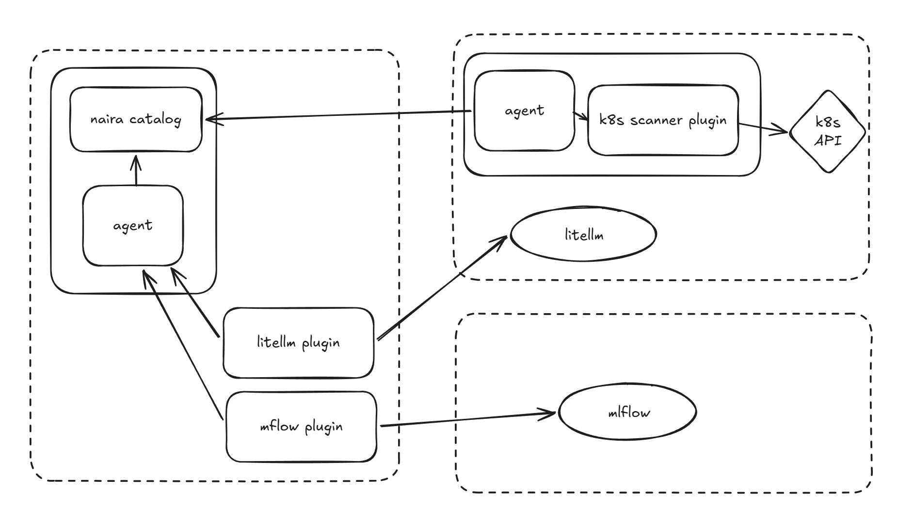

# ADR-012 - Remote Kubernetes Discovery and Plugin Execution Topology

## Context and Problem Statement

Naira needs to discover Kubernetes resources and other services in different customer environments. Some of these sources can be accessed directly from Naira. Others are inside private networks where direct access is limited or not allowed.

The [Remote Kubernetes Discovery and Plugin Execution Topology spike](https://github.com/naira-project/naira/issues/128) compared four models:

- **Model A:** Naira connects directly to sources and runs plugins centrally
- **Model B:** plugins run remotely, but Naira calls them directly
- **Model C:** an agent runs near private sources and connects outbound to Naira
- **Model D:** combines central collection (A) and agent-based collection (C)

The spike first recommended hybrid plugin placement, with an outbound-only agent as the default for Kubernetes discovery. The summary then recommended Model C.  After discussing this as a team, we agreed that customers may need either Model A or Model C, depending on their network and security requirements. We decided to chose Model D as our target architecture, supporting both models side by side.

We want to support both models without building two separate collection systems.

## Considered Options

1. **Model A - Central collection (chosen as part of Model D)**
   - Good, because it is simple when Naira can reach the source directly. No remote agent is needed.
   - Good, because plugins, collection runs, and updates can be managed centrally.
   - Bad, because Naira needs direct network access and may need to store source credentials centrally.
   - Bad, because central credentials can increase the impact of a security issue.
   - Bad, because direct access may not be possible in customer networks.

2. **Model B - Remote plugins called directly by Naira (not chosen)**
   - Good, because plugins run close to private sources and can use local credentials.
   - Bad, because Naira still needs inbound access to each remote plugin.
   - Bad, because each plugin needs its own network access and security setup.
   - Bad, because it does not solve the main network access problem.

3. **Model C - Outbound-only agent (chosen as part of Model D)**
   - Good, because the agent connects to Naira. Naira does not need inbound access to the customer's Kubernetes API or plugins.
   - Good, because local plugins can access private sources and keep source credentials in the customer environment.
   - Good, because the agent provides one controlled connection for local plugins.
   - Bad, because we need to install, register, update, monitor, and eventually remove agents.
   - Bad, because we must handle connection failures, retries, and temporary data storage.

1. **Chosen: Model D - Hybrid model (A + C)**
   - Good, because it works with both directly accessible sources and private customer networks.
   - Good, because plugins can run where they have access to the data they need.
   - Good, because both models can use the same data format, collection rules, and catalog.
   - Bad, because supporting two execution paths means more testing and maintenance.
   - Bad, because we need clear rules for where plugins run and what each component does.

## Decision Outcome

We will implement **Model D**, supporting both **Model A (central collection)** and **Model C (outbound-only agent)**. Both are supported options; one does not replace the other.

- **Model A - Central collection:** plugins run in central Naira and collect data from sources that Naira can reach directly. Their results go to the Naira catalog through the central collection flow.
- **Model C - Remote collection:** an agent runs in or near the customer environment. Local plugins use it to collect data from private sources, such as the Kubernetes API. The agent sends the results to Naira using an outbound connection. Remote plugins do not need public endpoints.
- **Plugin location depends on access:** in the target diagram, the Kubernetes scanner runs next to the customer's Kubernetes API, while the LiteLLM and MLflow plugins run centrally. These are examples, not fixed rules for those plugin types.

Both models must use the **same collection process and Naira catalog**. The data should have the same format and meaning, no matter where the plugin runs.

### Shared Principles

The spike identified several things we should keep in both models:

- **Stable cluster identity:** each cluster has a permanent `cluster_id` linked to a workspace. This ID does not change when the collection method changes. Cluster, agent, and plugin identities are separate.
- **One data contract:** all plugins return data in the same format, including discovered resources, relationships, and metadata. The processing and storage flow should not depend on where a plugin runs.
- **Full snapshots:** a successful collection run creates a complete snapshot for its scope. If a run fails or is incomplete, the previous complete snapshot stays active. We should report when data is old or a collection has failed.
- **Traceable data:** we should know which source, cluster, workspace, and plugin produced the data, when it was collected, and what the collection covered. For remote data, we may also need to record when Naira received it.
- **Limited permissions:** central and local credentials should only allow the required access. The remote agent must not become a general-purpose proxy or a way to run any command remotely.
- **Agent registration and identity:** remote agents need a secure way to register, get their identity and permissions, and have access removed when needed. Registration tokens and mTLS are possible building blocks, but mTLS alone does not manage the full identity lifecycle.
- **Reliable delivery:** remote collection must handle unstable connections, retries, buffering, and repeated or incomplete uploads. Only complete and validated snapshots should become active.
- **Small Kubernetes footprint:** for Kubernetes API discovery, a Deployment is enough. We do not need a DaemonSet on every node.

### What We Will Decide Later

This ADR chooses the **architecture**, not all implementation details. We will decide these as the work progresses:

- how agents communicate with Naira and authenticate
- how agents are registered, approved, and given or denied access
- how collection runs are scheduled and managed
- how agents and plugins are packaged, installed, updated, and kept compatible
- how retries, buffering, snapshot uploads, and status reporting work
- how we decide and describe where each plugin can run

For now, we are **not** deciding to build a full cluster-management system, automatically install or manage components in customer clusters, expose remote plugins directly, or use event-based/delta updates instead of full snapshots.

## Consequences

Supporting both models adds work for development, testing, and operations. We accept this because customer environments have different network and security needs.

The main rule is that **Model D is one collection system with two ways to run plugins**, not two separate systems. Both paths should keep the same cluster identity, data contract, snapshot rules, and catalog.

## Related Links

- [Spike: Remote Kubernetes Discovery and Plugin Execution Topology](https://github.com/naira-project/naira/issues/128)
- [Spike overview](https://github.com/naira-project/spikes/tree/main/spikes/014-remote-k8s-discovery-and-plugin-execution)
- [Spike recommendations and project findings](https://github.com/naira-project/spikes/blob/main/spikes/014-remote-k8s-discovery-and-plugin-execution/docs/summary.md)
- [Final team decision](https://github.com/naira-project/spikes/blob/main/spikes/014-remote-k8s-discovery-and-plugin-execution/docs/decision.md)
- [Target architecture layout](assets/adr-012-diagram.png)
- [Model A/B/C/D diagram](https://github.com/naira-project/spikes/blob/main/spikes/014-remote-k8s-discovery-and-plugin-execution/docs/model_a_b_c_d.excalidraw)

## Notes & Review Comments
- The team's final decision replaces the earlier idea that Model C might eventually replace Model A.
- The diagram shows the target layout. It does not define the final communication protocol, plugin lifecycle, or scheduler.
