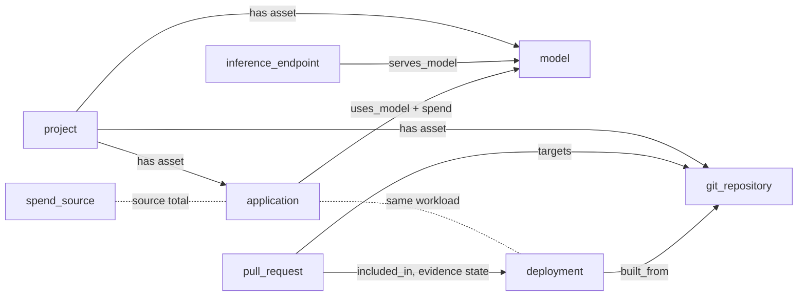

# RFC 012: AI Value Transparency

# Summary

Teams ask what AI costs them, what the total cost of ownership is and what they get in return. Each of these answers sits in a different tool today. This RFC proposes how Naira brings spend and delivery evidence into the hub. 

# Motivation

## The problem

A platform engineer who is asked "what does this AI application cost and who owns it?" joins the gateway's admin view with the catalog by hand. An AI engineer who is asked "how much of what our agents write runs in production?" traces commits through the registry and the GitOps repository by hand. A product owner who is asked "what do we get for the spend?" has a slide deck. The tools that hold the data do not share identities: a gateway knows keys and teams, a provider knows accounts, a cluster cost tool knows namespaces, a code host knows pull requests.

## What exists in code

- The LiteLLM plugin writes list prices and a 24 hour request count on `inference_endpoint` nodes and emits `application` nodes with `team`. It calls `/user/daily/activity` and reads only `api_requests`; the spend fields are ignored ([inference_endpoints.go](https://github.com/naira-project/naira/blob/f75922ba0169cf4bead904fd09121257a06c1ca2/plugins/cmd/litellm/inference_endpoints.go)).
- The Bedrock plugin stores token and invocation totals from CloudWatch and no cost ([bedrock/main.go](https://github.com/naira-project/naira/blob/f75922ba0169cf4bead904fd09121257a06c1ca2/plugins/cmd/bedrock/main.go)).
- The GitHub plugin verifies image attestations and emits `built_from` (deployment to `git_repository`) and `owned_by`. It keeps repository identity and drops the source revision and the digest. It reads no pull requests ([github README](https://github.com/naira-project/naira/blob/f75922ba0169cf4bead904fd09121257a06c1ca2/plugins/cmd/github/README.md)).
- The FluxCD plugin emits `references`, `sourced_from` and `deployed_from` without the applied revision ([fluxcd/main.go](https://github.com/naira-project/naira/blob/f75922ba0169cf4bead904fd09121257a06c1ca2/plugins/cmd/fluxcd/main.go)).

Not in code: any spend property, any kind for pull request or project, a spend view, time-range API routes. Projects are planned in [naira#335](https://github.com/naira-project/naira/issues/335). Langfuse as a cost source is planned in [naira#15](https://github.com/naira-project/naira/issues/15).

Several planned features depend on the same choices: spend from gateways, from provider cost interfaces and from OpenCost, governance gaps derived from spend, a pull request funnel, and spend per project. If each plugin picks its own property keys, the UI needs code per plugin, a gateway cannot be exchanged without losing the view, and nothing prevents a view from adding figures that cover the same money.

## Goals

- One way for any plugin to report spend, so a source can be added or exchanged without a UI change.
- Figures that must not be added (different basis, currency or window) cannot be added by accident.
- A view's total can be checked against what the source reports.
- AI involvement in code is followed from pull request to running workload through joins that can be verified.
- Spend and delivery evidence are related through the graph, at the grain of repository, application and project.
- No personal data and no secrets in any figure.

## Non-goals

- Billing, chargeback, invoices, budgets, alerts, forecasts and currency conversion.
- A spend ledger or long-term history in Naira.
- Figures per person.
- Who may see spend.
- Replacing gateways, FinOps tools, Langfuse, Grafana or engineering analytics platforms.

# Options considered

## How plugins report spend and where Naira keeps it

### Option A: Free property keys per plugin (status quo)

Each plugin adds keys such as `spend_usd_30d`.

- Pros: no decision, no catalog change, matches `invocations_total` today.
- Cons: UI code per plugin; basis, window and currency implicit or missing; no validation; nothing prevents adding metered and billed spend.
- Effort: none up front, growing with every source.
- Reversibility: high per plugin, but every view built on it must be rewritten.

### Option B: A reserved, versioned `spend` property on node and relation claims

Plugins put a JSON list of spend records in a documented format into the reserved property `spend`. The catalog validates it when present. Contract and store stay unchanged.

- Pros: no change to the proto, the database schema or the existing API routes; one format for every source; required basis, currency and window make the adding rules enforceable; additive; follows the tech radar plugin, which already stores JSON lists in string properties.
- Cons: weakly typed inside a string; aggregation happens in catalog code or the UI and not in SQL over typed columns; properties grow beyond the RFC-011 baseline; the first property with reserved meaning narrows "schema-less".
- Effort: small. A validator in the catalog, a helper in the plugin SDK, documentation.
- Reversibility: high. A plugin that stops emitting `spend` leaves no trace after its next run. The same fields map into Option C later.

### Option C: A typed spend message in the plugin contract with its own table and API

`CollectResponse` gains `repeated SpendClaim`. The catalog stores spend in a dedicated table and serves it under `/v1/spend` with filters.

- Pros: typed end to end; validation in the contract; efficient aggregation and filtering; spend does not inflate node properties; a natural place for retained history and more timely data later.
- Cons: changes the gRPC contract, the pgstore schema and the REST API at once; a larger database with its own growth model next to RFC-011; a spend table with an API is the start of a cost store, which pulls Naira toward a FinOps tool; hard to reverse once adopters query the API.
- Effort: large. Contract, store, migrations, API, SDK, conformance kit, sizing.
- Reversibility: low after the first release that exposes the API.

### Option D: Spend as time series in the operator's Prometheus, shown through Perses

Plugins or sources expose spend as metrics; Naira shows Perses panels per [RFC-005](rfc-005-perses-embedded-dashboards.md).

- Pros: history and trends without catalog growth; reuses the embedded dashboards and the `/prometheus/` proxy.
- Cons: a Prometheus-compatible store becomes mandatory for a core view; billing data is corrected for days and metric stores do not backfill well; the join from a series to owner, application and project happens outside the graph.
- Effort: medium, and it depends on RFC-005, which is a draft.
- Reversibility: high.

### Option E: Spend records as nodes of their own kind

- Pros: native to the graph.
- Cons: multiplies node count by sources and days; lists, search and the graph view fill with figures that are not assets.
- Effort: medium. Reversibility: medium.

### Comparison

| | UI change per source | Contract or schema change | Enforces adding rules | History | Drift toward cost store |
|---|---|---|---|---|---|
| A free keys | yes | no | no | no | low |
| B reserved property | no | no | yes | window only | low |
| C typed message and table | no | yes | yes | possible | high |
| D Prometheus | no | no | partly | yes | low |
| E record nodes | no | no | yes | window only | medium |

## How spend relates to development effort

### Option 1: Join through shared catalog nodes

Spend sits on applications, models and endpoints. Pull requests relate to a repository, and through build provenance and GitOps to a deployment. Both meet at repository, application and project for the same window.

- Pros: uses relations Naira already collects; no new identifier that tools would have to emit; honest about grain.
- Cons: answers "what did this project spend and what did it deliver", not "what did this pull request cost".
- Effort: medium. Reversibility: high.

### Option 2: Request-level attribution of model spend to a pull request or work unit

Gateway requests carry a tag or key per pull request, agent run or work unit, and Naira adds up spend per unit.

- Pros: cost per change, the figure many people ask for.
- Cons: no coding tool emits such an identifier consistently; LiteLLM tag spend is an Enterprise feature; it needs conventions that teams must adopt before any data appears; high risk of wrong joins.
- Effort: large, mostly outside Naira. Reversibility: medium.

### Option 3: Leave delivery analytics to an external tool and link to it

Naira shows spend and deep-links to Apache DevLake or a commercial platform for delivery figures.

- Pros: least work; respects "connect, do not replace".
- Cons: those tools stop at the merged pull request or at deployment counts and do not know AI assets or owners; the relation between AI work and running workloads stays invisible.
- Effort: small. Reversibility: high.

# Proposal

Option B for spend, Option 1 for the relation to development effort. Option C stays the named next step with explicit triggers. Option 3 applies to DORA metrics: Naira links out and does not compute them.

## Spend record format

Plugins report spend in the reserved property `spend` on the node or relation the figure belongs to. The value is a JSON list of records with `schema_version: 1`.

| Field | Required | Meaning |
| --- | --- | --- |
| `basis` | yes | `metered` (computed by a gateway from usage and prices), `billed` (reported by a provider's cost interface) or `infrastructure` (allocated cost of running a workload) |
| `amount` | yes | Decimal as string, not negative |
| `currency` | yes | ISO 4217 code |
| `window_start`, `window_end` | yes | UTC dates; start inclusive, end exclusive |
| `source_identity` | yes | `type` (`key`, `team`, `route`, `account`, `profile`, `workload` or `none`) and a display `label`; never a secret and never a person |
| `daily` | no | List of `date` and `amount` for the window; on nodes only |
| `complete_through` | no | Last UTC date the source regards as final; later days are provisional |
| `requests` | no | Request count for the same window |
| `price_basis` | no | How the source priced the figure (for example list prices) |

Rules:

- **Adding.** Figures are added only when basis, currency and window are equal. No currency conversion, no adding across bases.
- **Window.** One catalog-wide setting passed to every spend plugin: whole UTC days, default 30, at most 92. A plugin that cannot serve it reports the window it can serve, and views show that source separately.
- **Source total.** Each spend plugin emits one node of the new kind `spend_source` with the total the source reports for the window. Spend the plugin cannot attach to a catalog node stays there. Views compute "not attributable" as source total minus attributed spend.
- **Placement.** A figure sits on the node it describes (`model`, `inference_endpoint`, `application`, `deployment`). The split of an application's spend by model sits on the existing relation between them, with totals only.
- **No double reading.** Records on different node kinds are breakdowns of the same source total. A view adds within one kind, never across kinds.
- **Validation.** An invalid record is dropped with an error naming plugin, node, field and reason. The rest of the snapshot is applied.
- **Privacy.** `source_identity` has no type for a person. Plugins aggregate user identifiers away before reporting.
- **History.** None in Naira. Each run replaces the records with what the source returns for the window.

Size: a record with 30 daily values is about 1 KB, within the range RFC-011 examines as JSON x3 to x9. Relations carry no daily values, because 200 applications with 10 models each would otherwise approach the 4 MiB message limit.

## Reading spend

The UI needs totals and breakdowns over many nodes. Under Option B the catalog offers a read-only aggregation over the validated records, so the UI does not page through all nodes. Whether this is a new route or a parameter on the existing node routes is an open question. It adds no table and no write path.

## When to move to Option C

Option B is the start, not the end state:

- Adopters need spend history beyond the window inside Naira, and an external store (Option D) is not acceptable to them.
- Aggregation over properties exceeds an agreed response time at the sizes of RFC-011.
- Spend records regularly exceed the per-message limit.
- More than one consumer besides the Naira UI needs to query spend.

The record fields are chosen so that the move is a mapping and not a redesign.

## How spend and delivery meet

Relation names `targets`, `included_in` and `has asset` are proposals. The link between an `application` and its `deployment` does not exist as a relation today and is an open question.

A project page can then show, for one window: spend of its applications and models by basis, the pull request funnel of its repositories, how many AI-marked pull requests are included in running revisions, and the value hypothesis and KPI the owner declares. Naira places these side by side and computes no ratio between them.

## Views this enables

- A spend map: total, breakdown by model, application and team, with source, basis and window.
- Governance gaps: spend without owner, endpoints without consumer, models in use that the tech radar puts on hold.
- A pull request funnel per repository and its continuation to running workloads.
- Spend and declared value per project.

Each is a separate feature. This RFC decides only what they share.

## What becomes an ADR

- The spend record format and its rules.
- The `pull_request` kind, the marker rules and the evidence states.
- A later decision on history, either Option C or an external store, when a trigger above is met.
- A DDR for the spend map and for how evidence states are shown.

# Open questions

1. Is Option B acceptable as a start for the maintainers, or do the aggregation needs of the first spend view already justify Option C? 
2. Does the catalog's apply step support dropping one invalid record while applying the rest of a snapshot? 
3. Is the read-only aggregation a new route or a parameter on existing node routes, and does it need an update of RFC-004? 
4. Which catalog concept is the owner of record for spend: the `team` property, `owner` nodes from CODEOWNERS, or the project owner?
5. Which plugin creates the relation between an `application` and its `deployment`? 
6. May every signed-in user see spend per team and application until workspace authorization exists, or is the spend view an opt-in for operators? It demands the AuthN/Z Concept.
7. Is a `pull_request` kind in scope for a catalog of AI assets, or should delivery evidence stay as properties on `git_repository` and `deployment` only? 
8. Does the per-repository grain need a minimum number of contributors or pull requests before figures show, given co-determination rules in Germany?
9. How does a collector read agentgateway cost, and do Mistral and OpenRouter offer cost interfaces per model and day?

# References

- [RFC-004: Core API v1 design](rfc-004-core-api-v1-design.md)
- [RFC-005: Perses embedded dashboards](rfc-005-perses-embedded-dashboards.md)
- [RFC-010: Plugin ecosystem](rfc-010-plugin-ecosystem.md)
- [RFC-011: Database size estimate and limits for plugin output](rfc-011-db-estimate.md)
- [ADR-002: Build a custom catalog core](../adr/002-build-a-custom-catalog-core.md), [ADR-005: Switch to gRPC sidecars](../adr/005-switch-to-grpc-sidecars.md)
- [naira#15](https://github.com/naira-project/naira/issues/15), [naira#297](https://github.com/naira-project/naira/issues/297), [naira#335](https://github.com/naira-project/naira/issues/335)
- [LiteLLM spend tracking](https://docs.litellm.ai/docs/proxy/cost_tracking), [agentgateway cost tracking](https://agentgateway.dev/docs/kubernetes/main/llm/cost-controls/cost-tracking/), [Bedrock cost by application inference profile](https://docs.aws.amazon.com/bedrock/latest/userguide/cost-mgmt-application-inference-profiles.html), [OpenCost inference cost](https://opencost.io/blog/opencost-llmd-inference-cost/)
- [GitHub Copilot usage metrics](https://docs.github.com/en/copilot/reference/copilot-usage-metrics/copilot-usage-metrics), [SLSA provenance](https://slsa.dev/spec/v1.0/provenance), [DORA on AI](https://dora.dev/ai/)
